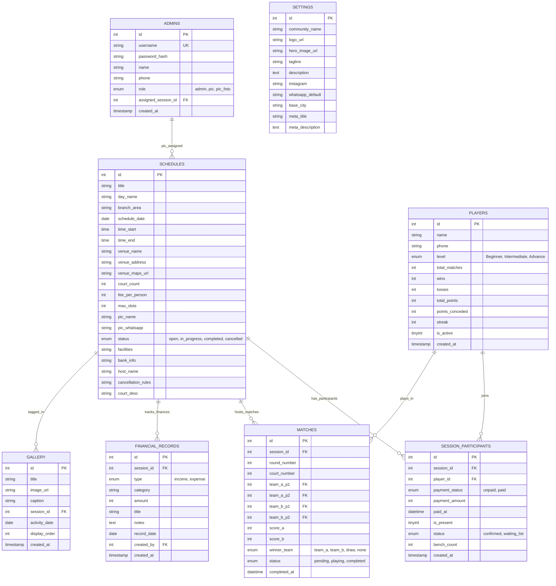

# 🛠️ DOKUMENTASI TEKNIKAL & ARSITEKTUR SISTEM
## Powershoot Badminton Club & Rotation Engine Platform

---

## 1. IKHTISAR ARSITEKTUR SISTEM (SYSTEM ARCHITECTURE)

Sistem **Powershoot Badminton** dibangun dengan arsitektur **Clean Native PHP (MVC-lite)** berkinerja tinggi tanpa ketergantungan framework berat (*zero heavy runtime bloat*). Sistem ini mengadopsi pola **Single Entry Dispatcher** dengan dukungan **Subdomain Routing & Clean URLs Engine**.

```mermaid
flowchart TD
    Client["Browser Klien (Desktop / Mobile / PWA)"] --> Htaccess[".htaccess Clean URL Engine"]
    Htaccess --> MasterDispatcher["Master Dispatcher: index.php"]
    
    MasterDispatcher -->|Subdomain / Path: /admin| AdminCMS["Admin CMS Panel (/admin/)"]
    MasterDispatcher -->|Subdomain / Path: /app| CourtApp["Courtside PIC App (/app/)"]
    MasterDispatcher -->|Subdomain / Path: /gallery| GalleryPage["Public Gallery (/gallery.php)"]
    MasterDispatcher -->|Path: / (Default)| LandingPage["Public Landing Page (/views/landing/)"]

    AdminCMS --> CoreModules["Core Modules (Auth, Database, Security)"]
    CourtApp --> CoreModules
    LandingPage --> CoreModules
    GalleryPage --> CoreModules

    CoreModules --> Models["Data Models (Schedule, Player, Finance, Participant, Match)"]
    Models --> MySQL[("MySQL / MariaDB Database")]
```

### Struktur Direktori Project:
```
smashpoint/
├── admin/                     # CMS Control Panel Pengurus
│   └── index.php              # Controller & View Admin Panel
├── api/                       # Endpoint AJAX / REST Internal
│   └── index.php              # API Dispatcher (Leaderboard, Skor, Rotasi)
├── app/                       # Aplikasi Lapangan PIC Sesi
│   └── index.php              # UI & State Lapangan (Absensi, Drawing, Skor)
├── config/                    # File Konfigurasi Lingkungan
│   ├── app.php                # Konstanta Sistem & App Config
│   └── database.php           # Kredensial MySQL (Local & Production)
├── core/                      # Engine Fondasi Sistem
│   ├── Auth.php               # Session Management & Role Enforcement
│   ├── Database.php           # PDO Singleton Connection Wrapper
│   └── Security.php           # HashId Obfuscator, CSRF, & XSS Sanitizer
├── models/                    # Data Access Layer & Business Logic
│   ├── Community.php          # Profil Komunitas, Galeri, & SEO Parser
│   ├── Finance.php            # Buku Kas, P&L Sesi, & Summary Keuangan
│   ├── MatchEngine.php        # Algoritma Rotasi Lapangan Cerdas (Smart Fair)
│   ├── Participant.php        # Manajemen Peserta Sesi & Status Bayar
│   ├── Player.php             # Roster Master & Akumulasi Poin Leaderboard
│   └── Schedule.php           # Jadwal Sesi Mabar, Kuota, & Relasi PIC
├── public/                    # Aset Publik
│   └── uploads/               # Direktori Upload Foto Galeri & Bukti
├── shared/                    # Aset & Skrip Terdistribusi (CSS/JS)
├── views/
│   └── landing/
│       └── index.php          # Landing Page Utama Publik
├── .htaccess                  # Apache Clean URL & 301 Strip Engine
├── database_backup.sql        # Skema SQL Standar utf8mb4
├── index.php                  # Master Dispatcher & Subdomain Resolver
├── manifest.json              # Web App Manifest untuk PWA / Android WebAPK
└── sw.js                      # Service Worker PWA Caching
```

---

## 2. SKEMA BASIS DATA LENGKAP (DATABASE SCHEMA)

Sistem menggunakan database relasional MySQL / MariaDB dengan *character set* `utf8mb4` dan *collation* `utf8mb4_unicode_ci`.



---

## 3. ALGORITMA ROTASI LAPANGAN CERDAS (SMART FAIR ROTATION ENGINE)

Algoritma rotasi (`models/MatchEngine.php`) memastikan pertandingan ganda (*doubles*) berjalan adil, merata, dan seru dengan 3 pilar utama:

### A. Bobot Istirahat (Bench Tracking Weight)
* Setiap kali seorang pemain tidak kebagian lapangan pada suatu ronde, counter `bench_count` bertambah:
  $$\text{PriorityScore} = \text{bench\_count} \times 100 - \text{matches\_played\_today}$$
* Pemain dengan nilai prioritas tertinggi dijamin bermain di ronde berikutnya.

### B. Penyeimbangan Level (Skill Balancing)
Setiap pemain memiliki bobot kemampuan:
* **Advance (A)**: Nilai 3
* **Intermediate (I)**: Nilai 2
* **Beginner (B)**: Nilai 1

Dalam 1 match ganda 4 orang ($A_1, A_2$ vs $B_1, B_2$):
$$\text{SkillGap} = |(\text{Skill}(A_1) + \text{Skill}(A_2)) - (\text{Skill}(B_1) + \text{Skill}(B_2))|$$
Sistem meminimalisir `SkillGap` hingga $\le 1$ untuk mencegah terjadinya pertandingan berat sebelah yang tidak menyenangkan bagi pemain pemula.

### C. Matriks Pasangan & Lawan Unik (Anti-Duplication Matrix)
Sistem mencatat riwayat pasangan di sesi tersebut. Algoritma menolak susunan tim jika pemain $X$ dipasangkan kembali dengan pemain $Y$ selama masih ada kombinasi pemain lain yang belum pernah berpasangan.

---

## 4. SISTEM KEAMANAN & PROTEKSI (SECURITY SPECIFICATIONS)

1. **Bcrypt Password Hashing**:
   - Seluruh password Super Admin dan PIC Lapangan di-hash menggunakan `password_hash($raw, PASSWORD_BCRYPT)` dengan *cost factor* default 10.
2. **Role-Based Access Control (RBAC)**:
   - `admin`: Memiliki hak penuh atas konfigurasi sistem, keuangan, hapus data, dan SEO.
   - `pic`: Dibatasi secara ketat hanya pada sesi yang ditugaskan (`assigned_session_id`). Tidak memiliki akses ke laporan keuangan kas atau manajemen akun.
3. **ID Obfuscation (HashId Engine)**:
   - ID numerik sesi pada tautan publik (seperti Galeri) di-encode secara kriptografis menggunakan `core/Security.php::hashId()` untuk mencegah *Insecure Direct Object References (IDOR)* dan *database scraping*.
4. **SQL Injection Prevention**:
   - 100% query database menggunakan **PDO Prepared Statements** dengan parameter binding bertipe ketat.
5. **XSS Sanitization**:
   - Seluruh output teks yang berasal dari input pengguna di-escape menggunakan `htmlspecialchars($str, ENT_QUOTES, 'UTF-8')`.

---

## 5. KONFIGURASI WEB SERVER & CLEAN URL ENGINE

File `.htaccess` di root direktori dikonfigurasi dengan aturan ganda:
1. **Pembersihan URL `index.php`**: Permintaan mentah yang mengandung file `index.php` di-redirect secara 301 permanen ke URL bersih (contoh: `/admin/index.php` menjadi `/admin/`).
2. **Reverse Routing**: Semua request yang bukan file statis fisik dialihkan ke dispatcher utama.

```apache
<IfModule mod_rewrite.c>
    RewriteEngine On

    # 1. Strip index.php from raw direct URL requests
    RewriteCond %{THE_REQUEST} ^[A-Z]{3,}\s/index\.php[?\s] [NC]
    RewriteRule ^index\.php$ ./ [R=301,L]

    RewriteCond %{THE_REQUEST} ^[A-Z]{3,}\s/([^/]+)/index\.php[?\s] [NC]
    RewriteRule ^([^/]+)/index\.php$ $1/ [R=301,L]

    # 2. Clean Gallery URLs: /gallery or /galeri -> gallery.php
    RewriteRule ^gallery/?$ gallery.php [L,QSA]
    RewriteRule ^galeri/?$ gallery.php [L,QSA]
    RewriteRule ^gallery/([a-zA-Z0-9_-]+)/?$ gallery.php?session=$1 [L,QSA]
    RewriteRule ^galeri/([a-zA-Z0-9_-]+)/?$ gallery.php?session=$1 [L,QSA]

    # 3. Allow direct access to real existing files and directories
    RewriteCond %{REQUEST_FILENAME} !-f
    RewriteCond %{REQUEST_FILENAME} !-d

    # 4. Master Dispatcher
    RewriteRule ^(.*)$ index.php?page=$1 [QSA,L]
</IfModule>
```

---

## 6. PANDUAN DEPLOYMENT & MIGRASI DATABASE

### A. Deployment ke InfinityFree / cPanel
1. Masuk ke **File Manager** hosting (folder `htdocs`).
2. Upload seluruh file dari direktori `C:\laragon\www\smashpoint\` (atau upload file `Powershoot App 1.0.zip` lalu ekstrak di dalam `htdocs`).
3. Sesuaikan file konfigurasi database di `config/database.php`:
   ```php
   'host' => 'sql102.infinityfree.com',
   'dbname' => 'if0_43342514_smaspoint',
   'username' => 'if0_43342514',
   'password' => 'YOUR_HOSTING_PASSWORD',
   'charset' => 'utf8mb4'
   ```
4. Buka **phpMyAdmin** di panel hosting, pilih database Anda, lalu import file `database_backup.sql`.

### B. Troubleshooting InfinityFree Anti-Bot
InfinityFree menggunakan sistem proteksi bot bernama *AesirShield* yang mewajibkan eksekusi JavaScript browser resmi.  
* **Solusi Mobile**: Gunakan browser resmi Google Chrome di Android, lalu gunakan fitur **"Instal Aplikasi" / PWA (WebAPK)** agar aplikasi berjalan mandiri dan lolos proteksi 100%.
